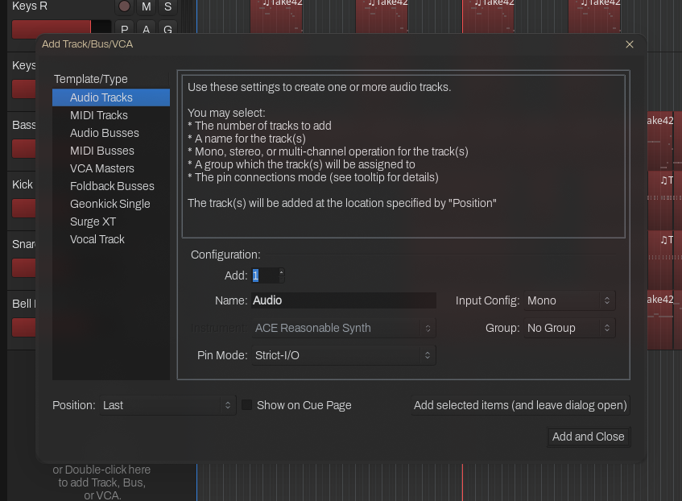
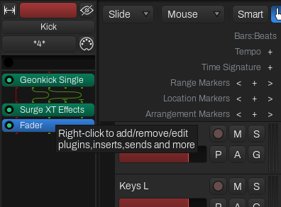
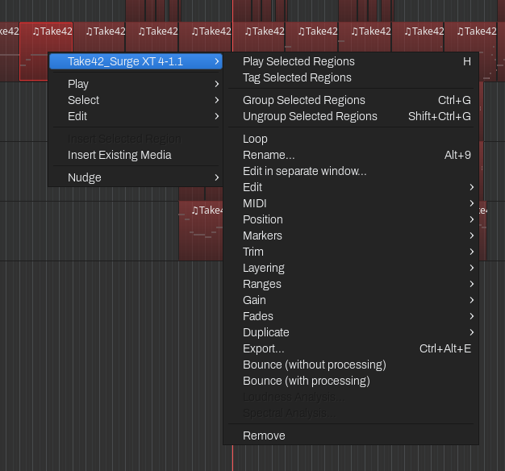
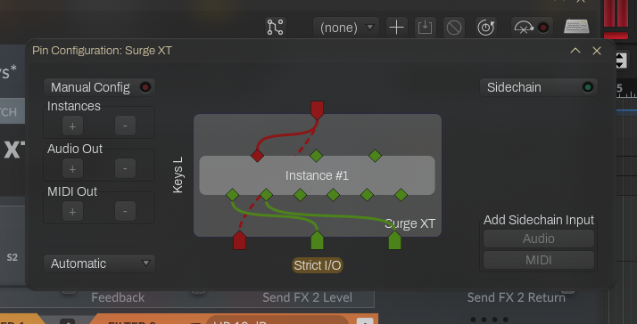
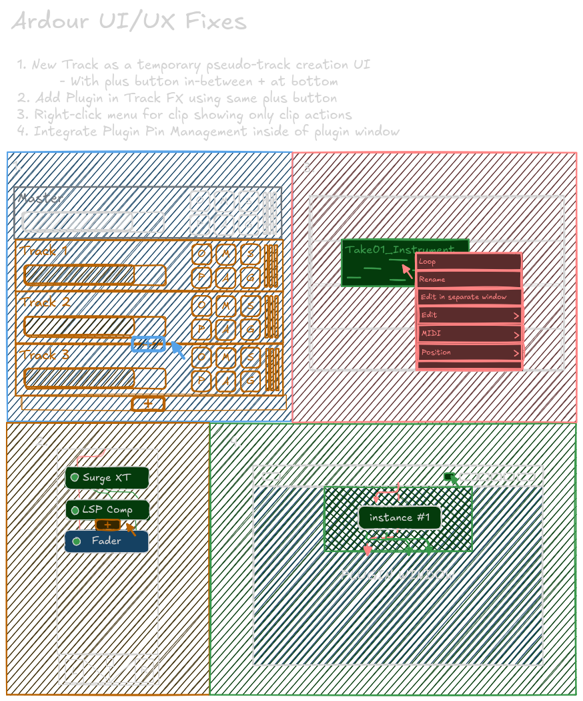
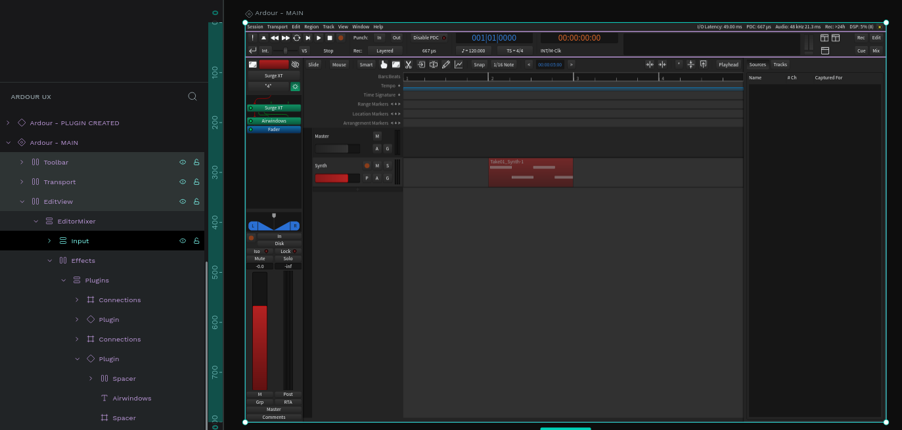
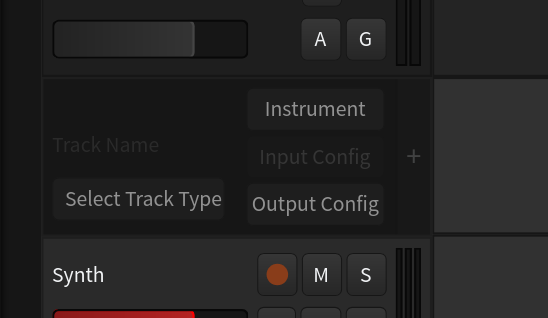
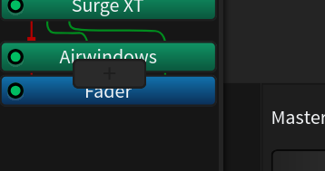
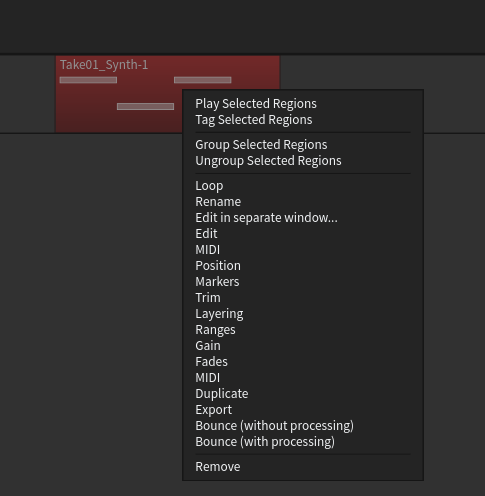
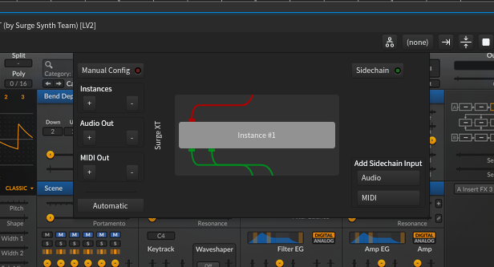

  <iframe
    width="560"
    height="315"
    src="https://www.youtube.com/embed/uIfVWljW_2A?si=tkVefK4fD0AogE19"
    title="YouTube video player"
    frameborder="0"
    allow="accelerometer; autoplay; clipboard-write; encrypted-media; gyroscope; picture-in-picture; web-share"
    allowfullscreen
  ></iframe>

## Project Overview

- **Type**: UX Concept / Revision
- **Role**: UX Designer (Solo)
- **Timeline**: 1 week
- **Goal**: Improve the UX of the open source audio workstation Ardour

---

## Context

Ardour is a mature **open-source** digital audio workstation. Though it has an innovative and intuitive workflow and rich set of features that allow me to use it as my primary audio tool, there are some **points of friction** with its UX that should be addressed.

---

## The Problem

While using Ardour, I found some specific actions that I felt were not that intuitive or took too much time to complete. When it comes to creative tools, even seconds extra of completing a task can interrupt the creative process, and slowly lead to burnout. This is true for someone like me who has been using Ardour and similar tools for many years, but only so much more for someone picking it up for the first time.

So to begin, I compiled a list of four or so actions that I feel could be improved.

### Selected Actions

The actions that I decided to focus on are:

- Creating a new track
- Adding a new plugin to a track
- Editing a MIDI/Audio clip in edit view
- Accessing a plugin's pin connections

I found that a common theme with the user experience of Ardour is many actions call up a popup window or dialog box, and or require extensively navigating the interface to complete.

  

    
    
Current Ardour Track Creation

  

  

    
    
Current Ardour Plugin Adding

  

  

    
    
Current Ardour MIDI/Audio Clip Editing

  

  

    
    
Current Ardour Plugin Pin Connections

  

Here were my thoughts on each action as I was auditing the user experience:

#### Creating a New Track

The Add Track popup menu is too much for the basic operation of creating a track.

#### Adding a Plugin

When adding a plugin in any view except the mixer view, the user has to very precisely right click in-between two existing plugins to insert the new one.

#### Editing a MIDI/Audio Clip

The dialogue for editing a clip shows too much additional options (options related to playback and selection).

#### Accessing a Plugin's Pin Connections

A popup window is unnecessary for accessing a plugin's pin connections.

### Design Goals

The aim was to address these UX issues while retaining the overall user interface and experience of Ardour

- **Integrated UI**: UI elements should be integrated into the existing Ardour interface, without relying on popup windows wherever possible.
- **Removed Distractions**: The user should be only presented with the information necessary to complete the given action.
- **Consistent Aesthetic**: Any new user interface elements should be consistent with the design of Ardour.

---

## Solution

#### Ideas and Wireframing

Before going to the drawing board (Excalidraw) I first thought about the four specific problems I addressed and what different solutions could be implemented. I then quickly sketched out the solutions I arrived at.

  

Each of these solutions keep my main design goals in mind and provide a simpler and less busy interface.

For both track and plugin creation, I thought to use a consistent 'add button' element that dynamically appears on mouse hover close to the element.

For clip actions, I simply thought to remove the nested submenu and just show the clip-specific actions.

For the plugin pin connections I went with simply integrating the window into the plugin interface itself, instead of being a separate popup.

#### Prototyping

I then prototyped the solutions using Penpot, which is an open-source alternative to Figma.

Before integrating the solutions directly, I first created a full mockup of Ardour inside of Penpot with reusable components and tokens. This took many hours to complete, but was totally worth it to ensure my solutions would be consistent with the existing interface.

  

I then began creating the solutions in Penpot, integrating them into the mockup as I went. Again, this took a lot of time and many revisions, but I ended up with some solutions that worked well and aligned with my design goals.

  

    
    
Revised Ardour Track Creation

  

  

    
    
Revised Ardour Plugin Adding

  

  

    
    
Revised Ardour MIDI/Audio Clip Editing

  

  

    
    
Revised Ardour Plugin Pin Connections

  

To see more, and interact with the prototype, view the Penpot live viewer [here](https://design.penpot.app/#/view?file-id=502b4555-3f5f-807a-8008-8ad31e070cf5&page-id=3a0fa80b-a351-807d-8008-8a2b18b8bc13&section=interactions&index=0&share-id=502b4555-3f5f-807a-8008-8aeeedcbc306){:target="_blank"}.

## Takeaways

What I got out of doing this project more than anything is realizing just how passionate I am about doing UX work for open source projects. Despite being my first official UX project surrounding open source software, I am excited to contribute more wherever I can.
