## Project Overview

- **Type**: UX Concept / Feature Addition
- **Role**: UX Designer (Solo)
- **Timeline**: 1 week
- **Goal**: Design a fitness-focused feature extension to Endel

---

## Context & Problem

Endel is an adaptive audio platform that generates real-time soundscapes to support focus, relaxation, and sleep. While its system utilizes factors like the time of day or heart rate, its use cases have remained mostly passive; background audio for stillness or productivity.

Currently, Endel is missing extensive support for physical activity. Users who rely on Endel for cognitive tasks currently have to turn elsewhere for their physical routines, breaking continuity and brand loyalty. Existing integrations, such as Apple Health, could be utilized to a greater degree, and the app doesn’t offer any motion-aware audio tracks beyond walking detection.

This project explores how Endel could expand into active states of performance; specifically strength and cardio training. In doing so, Endel’s core values of minimalism, adaptability, and user flow will be kept intact.

---

## Research & Assumptions

As a speculative feature extension, this project was not based on user interviews or direct requests. Instead, it draws on patterns in adjacent behavior: many users integrate Endel into daily routines that support wellness, focus, and mood regulation. Meanwhile, fitness routines; specifically strength and cardio training; often rely on separate apps or playlists, creating a fragmented experience.

#### This project assumes:

- Users interested in cognitive optimization are likely also engaged in physical activity.
- Endel's ambient, adaptive audio engine could extend into movement-based contexts.
- Existing fitness apps focus on metrics and playlists; few offer adaptive soundscapes that evolve with effort or movement style.
- Endel users prefer minimal control and low friction; new features should preserve that philosophy.

The design challenge was to explore how Endel could meet these parallel needs without overextending and convoluting its identity.

---

### Design Goals

The aim was to expand Endel’s sound ecosystem into active physical states without compromising its core principles of minimalism, adaptability, and fluid UX.

- **Seamless Integration**: The new tracks should feel native to Endel, both visually and functionally. No confusing navigation patterns or unnecessary screens.
- **Low Input, High Responsiveness**: Users should not need to log workouts or interact extensively mid-session. Tracks should adapt to broad types of exertion.
- **Intuitive Onboarding**: Users should understand the purpose and difference of each track quickly.

---

## Solution

Endel Boost introduces four new adaptive tracks designed specifically for physical activity. Each track is tailored to a distinct combination of exertion type (cardio vs. strength) and performance mode (endurance vs. power):

- **Pace (Cardio Endurance)**: steady output for runs, hikes, or other longer-duration cardio sessions.
- **Push (Cardio Power)**: high bursts for sprints, intervals, HIIT, or other maximal effort cardio sessions.
- **Move (Strength Endurance)**: circuit-style lifting, calisthenics, or other high rep continuous-effort strength sessions.
- **Lift (Strength Power)**: heavy lifts, short bursts, and other low rep maximal effort strength sessions.

  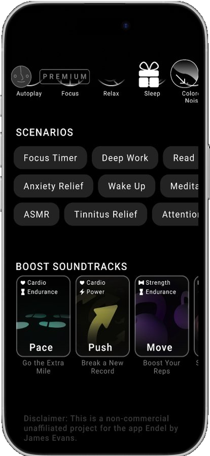
  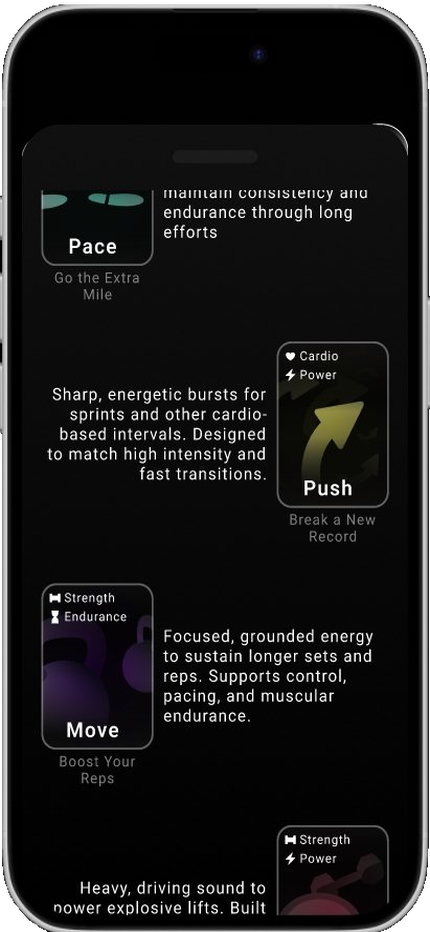

These were designed to complement workout data from external sources like Apple Health, adapt sound dynamically based on session context, and require minimal tweaking during workouts while still providing user control.

The onboarding occurs through a short in-app introduction that mirrors Endel’s current new-features section. Users read a short article explaining what Endel Boost is and how to use it.

  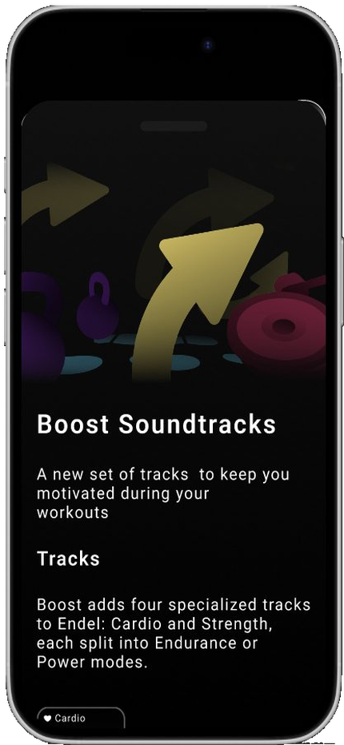
  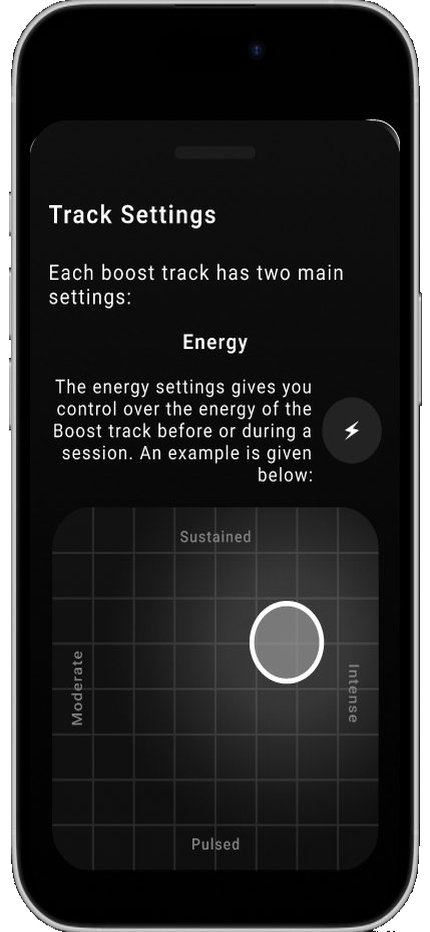
  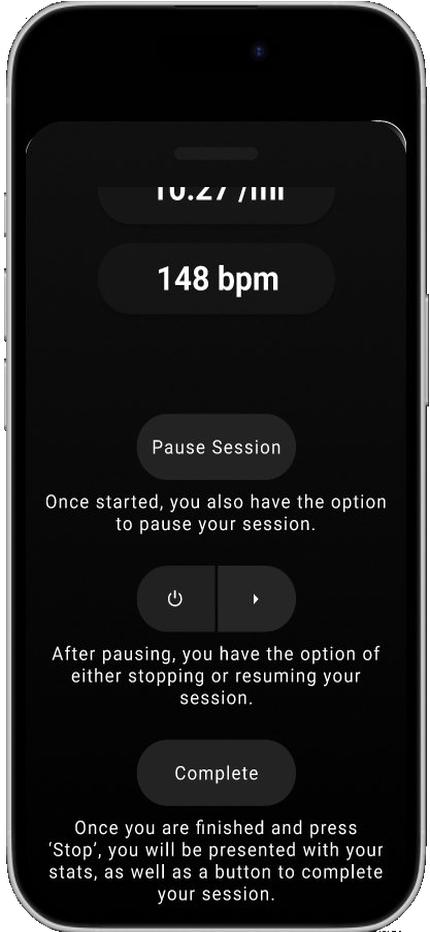

The track-selection interface integrates into Endel’s current dashboard and utilizes a card-based system. Each card features a color-coded visual indicating the workout type. The choice to add color was a deliberate departure from Endel’s primarily monochromatic identity; used here to communicate high energy. Workout type is further indicated by labeled iconography distinguishing cardio vs. strength and endurance vs. power.

  

Session screens keep to Endel’s visual language, offering minimal controls based on workout style. Users can adjust two settings:

- **Intensity**: mirrors Endel’s current track-specific settings, utilizing a 2-axis grid to dial in the intensity and general feel of the track.
- **Length**: a new interface element that retains Endel’s minimalist visual identity.

  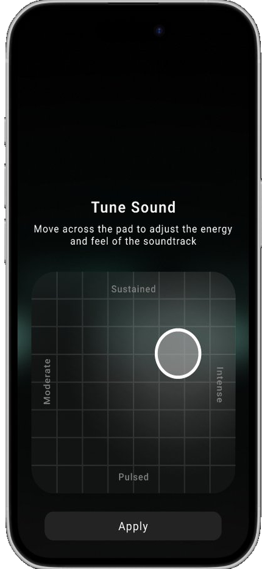
  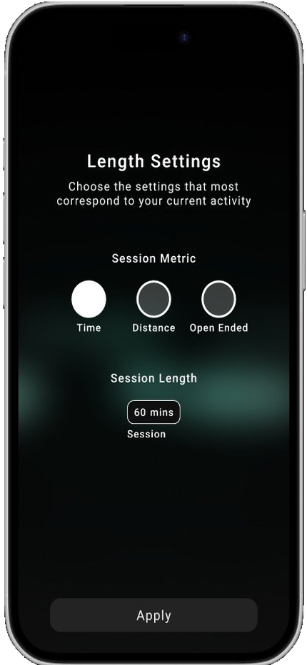

Sessions contain a play sequence that, on play, displays various workout-related metrics.

  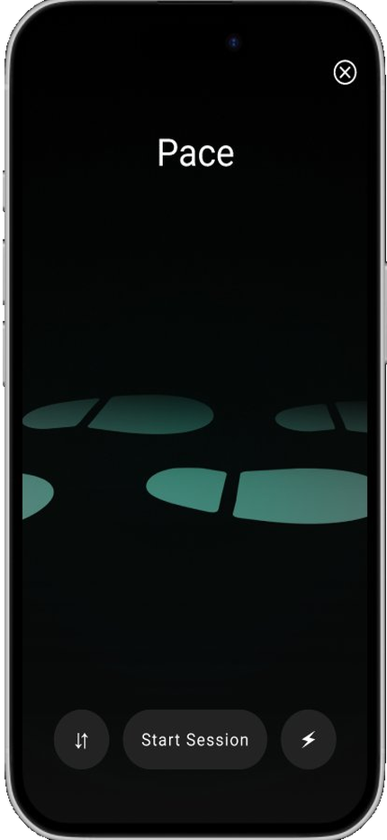
  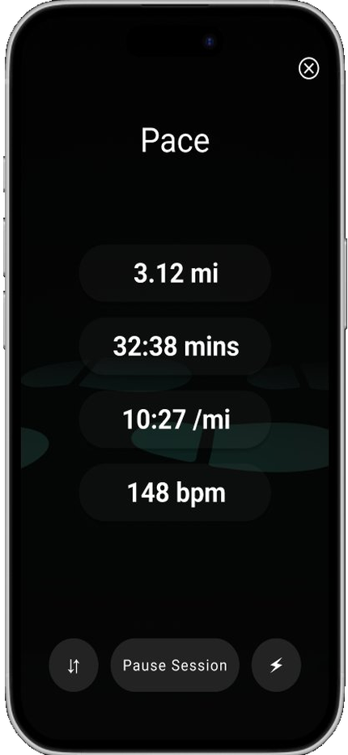
  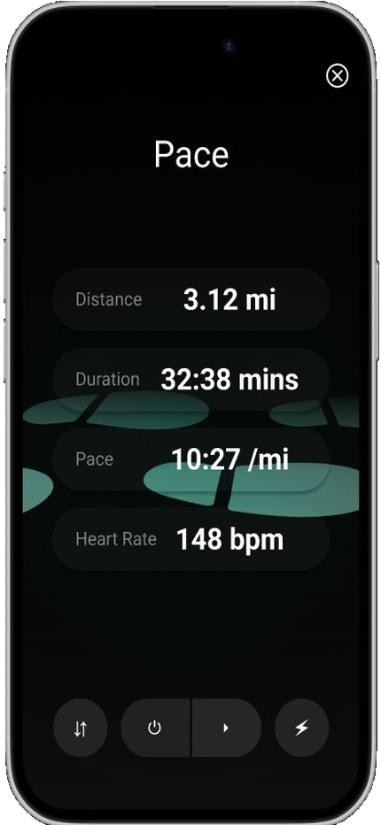
  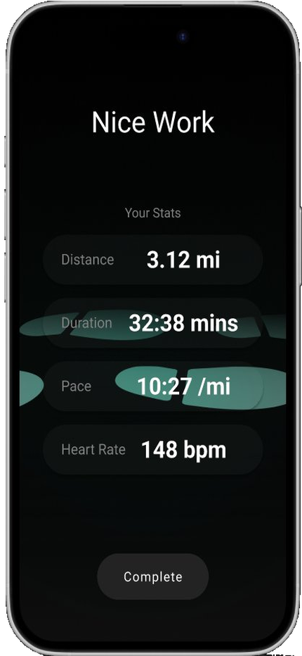

This solution preserves the low-friction user experience of Endel while opening the door to more potential use cases.

---

## Reflection

### What Worked

- Designing within clearly defined constraints kept the features coherent and aligned with the brand.
- The four tracks offered clarity and inclusion of various types of physical activity while avoiding overwhelming choice.
- Visual and interaction patterns stayed consistent with the existing product, minimizing friction.

#### What Could Be Improved

- Without real user data or testing, assumptions around workout behavior and preferences remained speculative.
- Sound logic was not prototyped; this remains a UI/UX concept without audio implementation.
- The entire user experience could benefit from iterative testing to ensure clarity.

#### What I Would Do Next

- **User Testing**: Observe how users interpret the new tracks and whether onboarding communicates the differences effectively.
- **Sound Design Prototyping**: Draw on both collaboration and my own background in sound design to define how each track should respond to movement types.
- **Behavioral Integration**: Explore how the tracks could respond to real-time data from Apple Health or wearables without overwhelming the user.
- **Long-Term Use Patterns**: Test whether users stick with Boost over time, refining the experience accordingly.

---

While the initial concept emphasizes restraint and alignment with Endel’s identity, more time and resources would allow for deeper experimentation and user-informed iteration.
