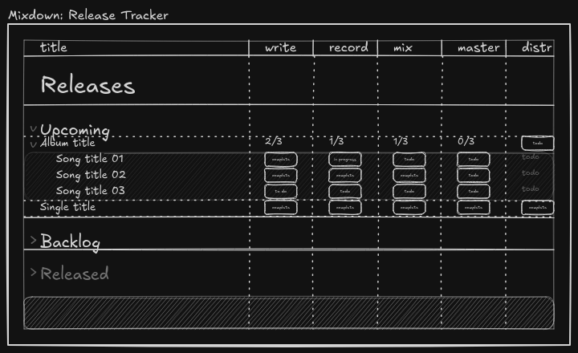
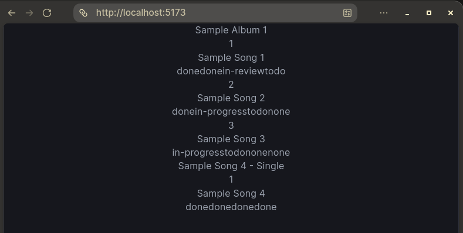
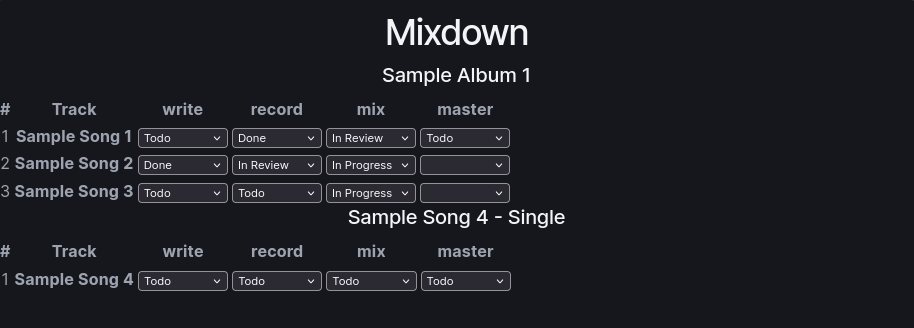
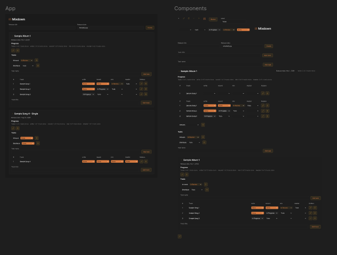
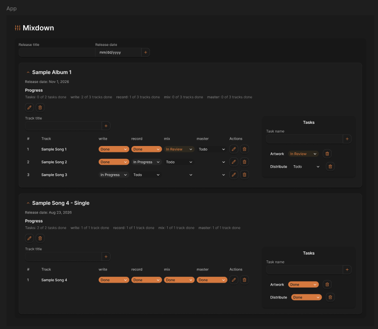
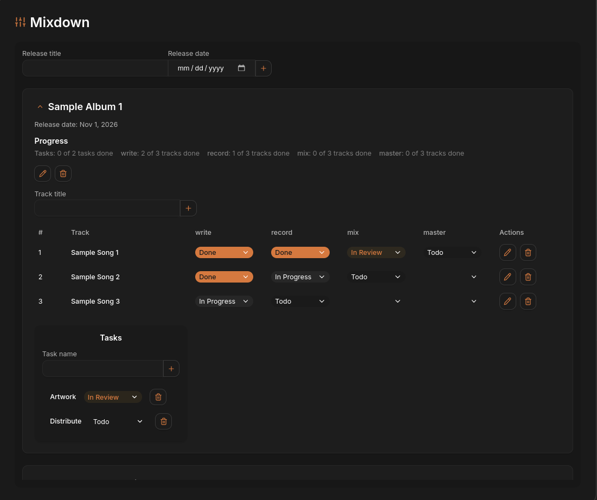

## Project Overview

- **Type**: Product Design / Frontend Development
- **Role**: Product Designer / Frontend Developer (Solo)
- **Timeline**: 1 week
- **Goal**: Design and build a small, accessible app for tracking a music release from first draft to distribution

---

## The Context

As a music producer, releasing anything means keeping track of a lot of unfinished work at once: which songs are mixed, which are mastered, whether the artwork is done, and what is actually blocking the release date. I have tried tracking this in generic to-do apps, but they flatten everything into a single list and lose everything that goes into the work.

So I made **Mixdown**. It organizes work around the *release* instead of the task: a release holds tracks and release-wide tasks, and every track moves through the same stages.

---

## The Approach

### Scoping the Problem

I started by defining a small MVP: create releases, add tracks, set a status for each production stage, manage release tasks like artwork and distribution, and persist everything in localStorage.

The central design decision was the **stage view**. Tracks are rows, while stages (write, record, mix, master) are columns; each cell holds one of five statuses. Reading across a row tells you where a song is, and reading down a column tells you what is holding the release up. That grid is the whole product, so I started by sketching it and then built it before anything else.

### Sketching the Idea

Before writing any code, I sketched the stage view in Excalidraw to test whether the grid actually read well.

The sketch settled a few things early:

- Releases and their songs share one set of stage columns, so everything lines up.
- Each release row rolls up its tracks ("2/3" under write), so progress is visible without expanding it.
- Releases are grouped by where they are in their life: upcoming, backlog, and released.
- Release-wide work like distribution sits in the same grid as a final column.

Not all of this made the MVP, but the core grid and the per-stage progress carried straight through to the final build.

  

### Data First

I decided to build the whole app before touching any visual design. I set up the React, Vite, and TypeScript project myself and started with the data model: a `Status` type with five values, a `Track` with a status per stage, a `Task`, and a `Release` that owns both lists. Getting this right early meant the UI was mostly a direct reflection of the data.

  

My first render was just the state dumped onto the page, to check that the model and the statuses were right.

Seeing "donedonein-reviewtodo" run together was not pretty, but it showed the shape of the data worked.

### A Working Table

Next I turned that data into the actual stage grid, with a dropdown per cell wired to state. From there I built out all of the functionality: creating, editing, and deleting releases, tracks, and tasks, collapsing releases, per-stage progress summaries, and saving everything to localStorage. It was still unstyled, but at this point it was a tool I could actually use.

  

### Designing the Interface

With a fully working app, I moved into Figma. Designing last meant I knew exactly what the interface needed to do. I used Claude Code to turn the HTML output of my TypeScript into a first pass of the design in Figma, which gave me a real, editable starting point that directly referenced what I had built.

  

It captured the structure well, but it was generic. Furthermore, there were some accessibility and usability nightmares. I took over from there and styled it myself, giving it a dark surface with a single orange accent that is used only for things you can act on and for completed states.

I was able to be a lot more immediately creative with the design as I ensured Claude Code made everything a design token and component.

  

A few decisions I made along the way:

- **Never color alone**: Each status has a text label as well as a color, so progress is readable without relying on hue.
- **Progress at a glance**: Each release shows a summary per stage ("write: 2 of 3 tracks done") so you do not have to scan the grid to know where you are.
- **Collapsible releases**: A release you are not working on should get out of the way.
- **Keyboard and semantic first**: Real labeled form controls, visible focus states, and semantic HTML, so accessibility came from the structure rather than being patched on afterwards.

### Final Build

Since the app already worked, the last step was applying the design to it. I translated the Figma tokens and components into CSS and swapped the plain controls for the styled ones, without having to change how anything functioned. Then I deployed it on Netlify.

  

Check the source code in my Github repository to see how it is built!

---

### Takeaways

Building the app first and designing it second was a different order than I usually work in, and it paid off. Settling on releases, tracks, stages, and statuses early meant the visual work could focus on clarity instead of figuring out what the app was.

In doing this project, I learned:

- Building a React and TypeScript app from the data model outward
- Designing on top of working code, using Claude Code to bring it into Figma
- Building accessible status UI that does not rely on color

There are some features that I may add in the future, but overall it was a really cool experience designing and developing with React for the first time.
