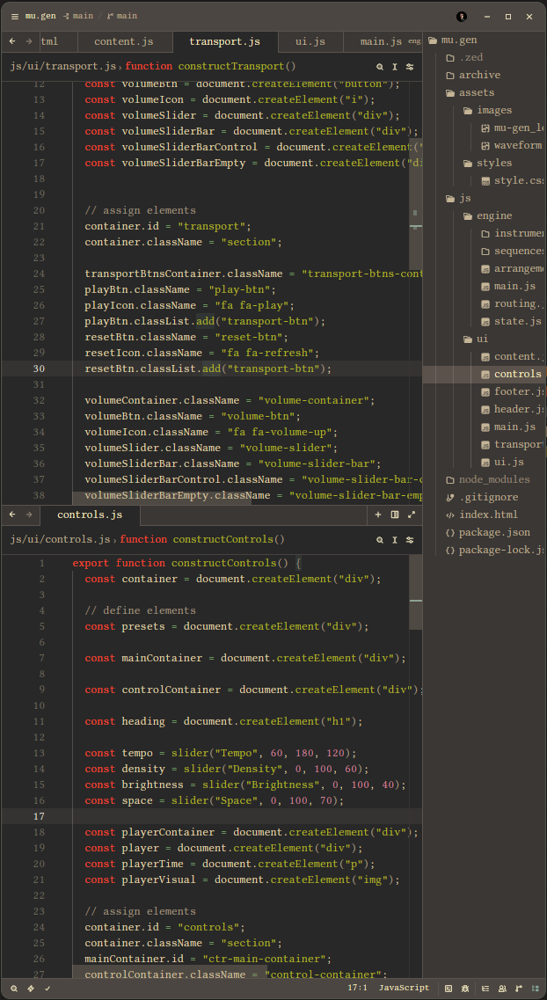
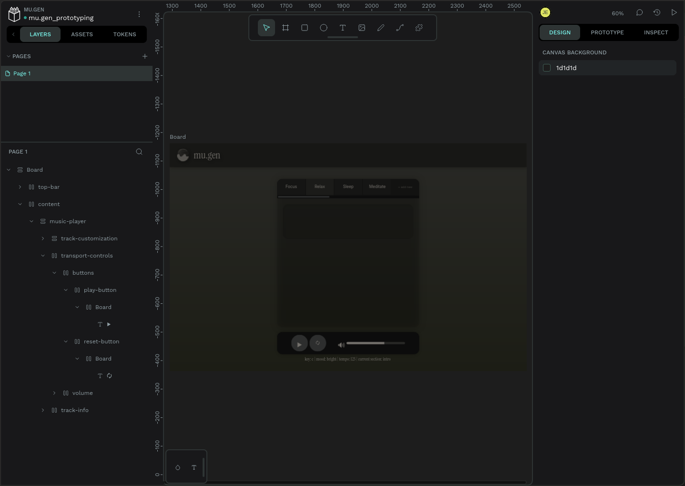
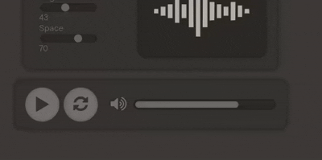
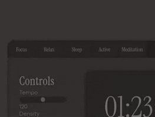
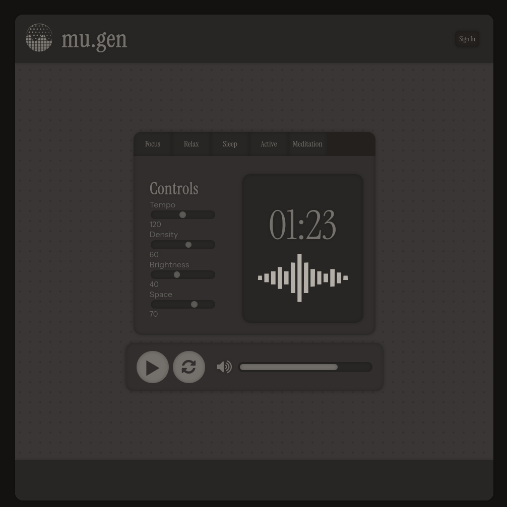

## Project Overview

- **Type**: Frontend Development
- **Role**: UX Engineer / Frontend Developer (Solo)
- **Timeline**: 2 weeks
- **Goal**: Create an initial frontend and UI system for my project **mu.gen** with HTML, CSS, and JS

---

## The Context

I have always had a personal interest in the world of audio and music technology. Recently, I have used various *functional audio* apps, and with all of them I have ran into the same issue: **The musicality and sounds themselves are pre-made**. Some apps of this kind will procedurally arrange existing audio, thus only allowing for so much novelty. The idea of functional music is for it to be truly in-the-background, and when I would hear the same sounds again and again, I found myself thinking about the music instead of the work, relaxation, sleep, or other activity at hand.

And so, I thought of **mu.gen**. The premise is it uses on-the-fly synthesis, composition, and arrangement to create truly unique tracks that are formed algorithmically to fit any given context you choose.

<b>Clarification:</b> I do not plan on it being an AI app in any way, despite the name. It is procedurally generative audio.

---

## The Approach

### Starting the Project

I started with creating a foundational backend architecture for the music generator itself initially using JavaScript and Tone.JS.

  

I quickly found how complicated creating a procedural music system would take, so I decided that for the scope of this project I would benefit from prioritizing the frontend development as the highest-leverage work. I got enough working to serve as a basic proof of concept for the system itself though.

Some of the things I built are:

- Modular audio signal path routing setup
- Numerous programmed synths that could be played via sequences
- Procedural arrangement system for song sections
- State management to change various aspects of the song

What I ultimately decided what would be best for the project is for me to get a working frontend before I continue delving into the specifics of the sound engine itself; especially as frontend development is my highest-leverage skill.

### UI Conceptualization

I wanted to ensure that I have a good understanding of what I was going to be building, so I first designed a rough prototype in Penpot.

I usually don't spend too long on the visual prototyping phase too long; I really just like to get a basic structure and visual aesthetic started to get a good idea of where to begin building.

As will be shown, this initial design prototype gave me a good direction for my final frontend design.

  

### Frontend Development

When doing frontend development, I always aim to make the UI as modular as possible. This project was no exception. I needed to ensure that I was designing the frontend in such a way that it could:

- Actually function and communicate with the backend (such as play/pause)
- Be easily reconfigurable for different layouts
- Have components be generated via functions

Instead of writing a static html page, I opted to write the UI with JavaScript so I could achieve these goals and specifications.

  
  
  

Check the source code in my Github repository to see how I went about making this!

---

### Takeaways

Aside from making progress with this large project of mine, doing this frontend design helped me sharpen my current skills and learn new practices.

In doing this project, I learned:

- Modular frontend design with JS
- Interactive UI state management
- Advanced CSS styling and animation

Having created this project with only HTML, CSS, and vanilla JavaScript, I am confident with my ability to translate my visual design intuition into functional frontend interfaces.
