## Overview

During my 3 years at UNC Asheville, I spent countless hours developing skills and finding new interests. Studying New Media, I was able to explore a wide variety of digital creative mediums.

---

## After All - Music Video

Award winning 3D Animated music video for Corvus Echoes' song *After All*. Created in Blender.

  <iframe
    width="560"
    height="315"
    src="https://www.youtube.com/embed/IzCGgZiOkEk"
    title="After All - Corvus Echoes"
    frameborder="0"
    allow="accelerometer; autoplay; clipboard-write; encrypted-media; gyroscope; picture-in-picture; web-share"
    allowfullscreen
  ></iframe>

---

## Lunar 3D Environment

Series of renders from a 3D lunar environment made in Maya.

  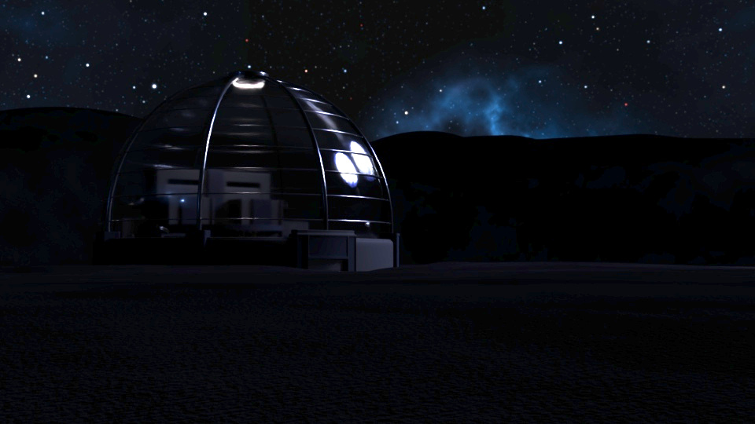

  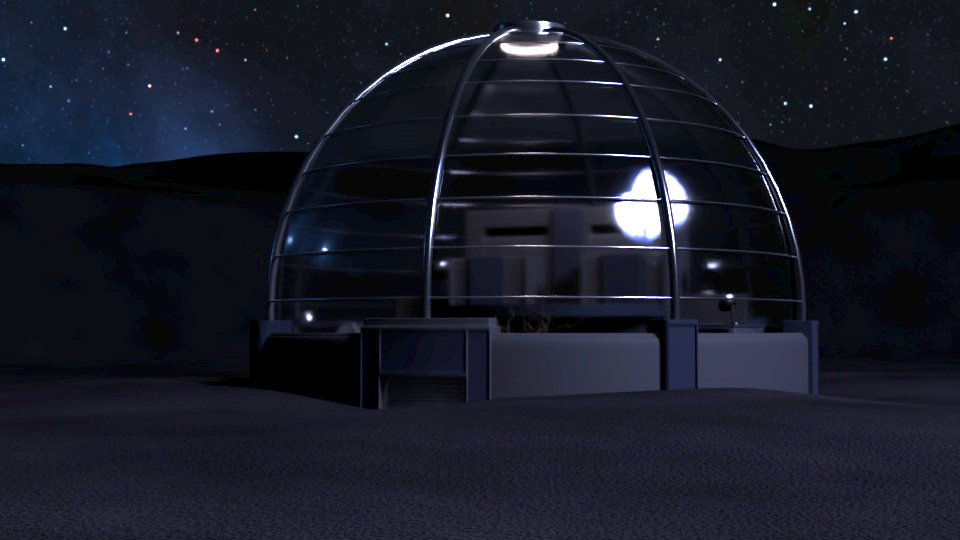
  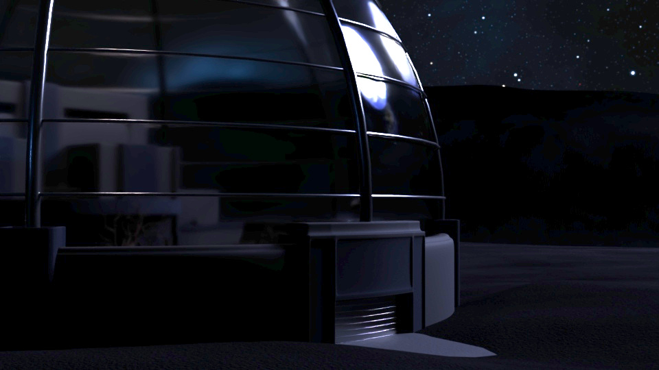
  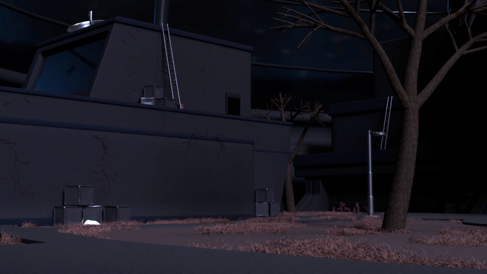
  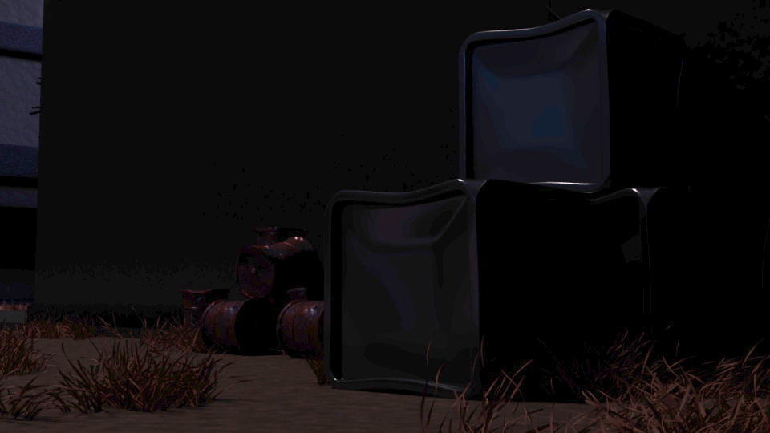
  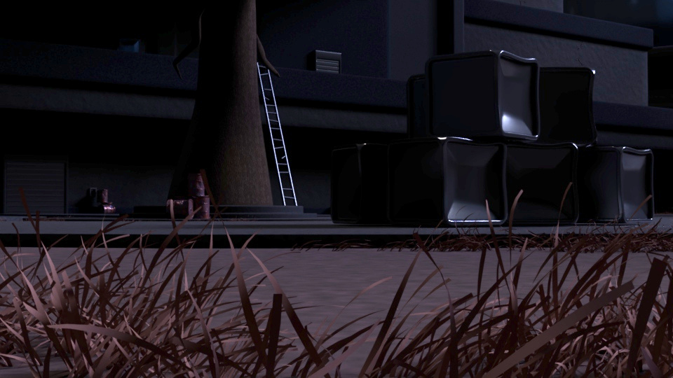
  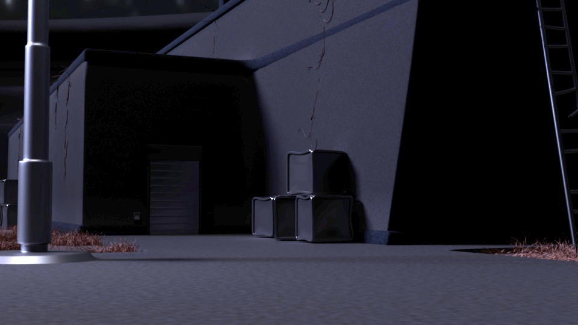
  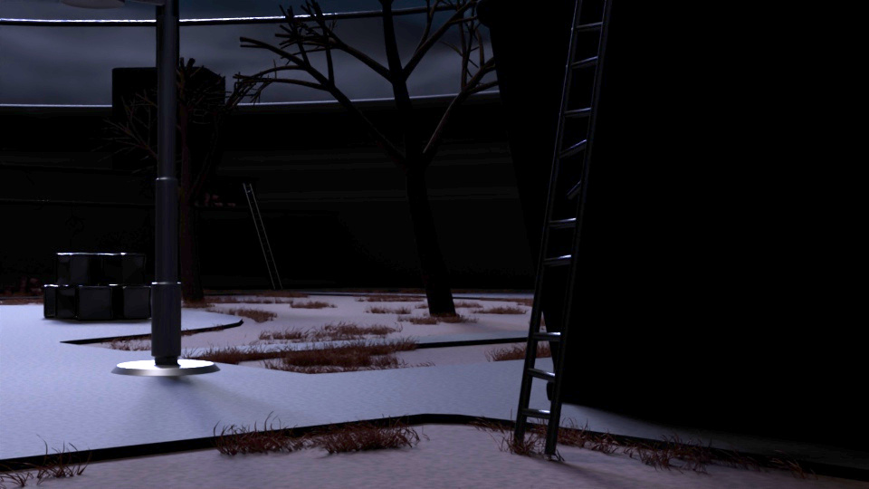
  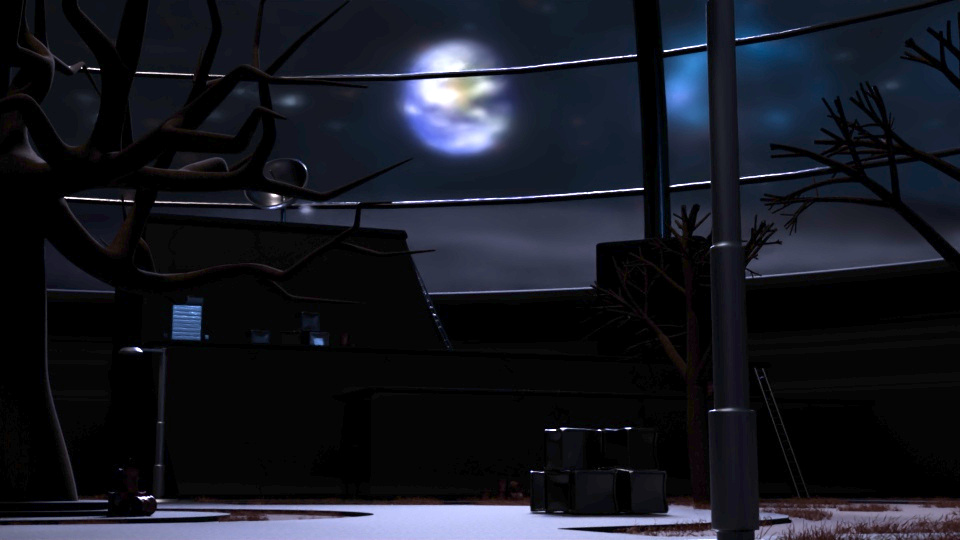
  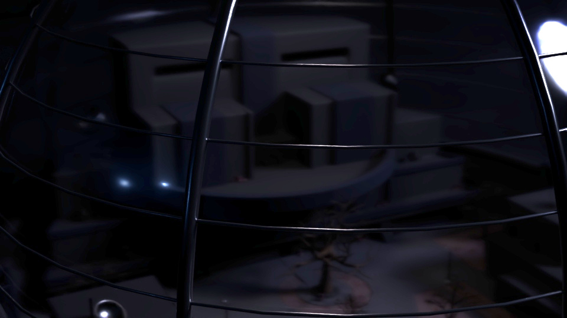
  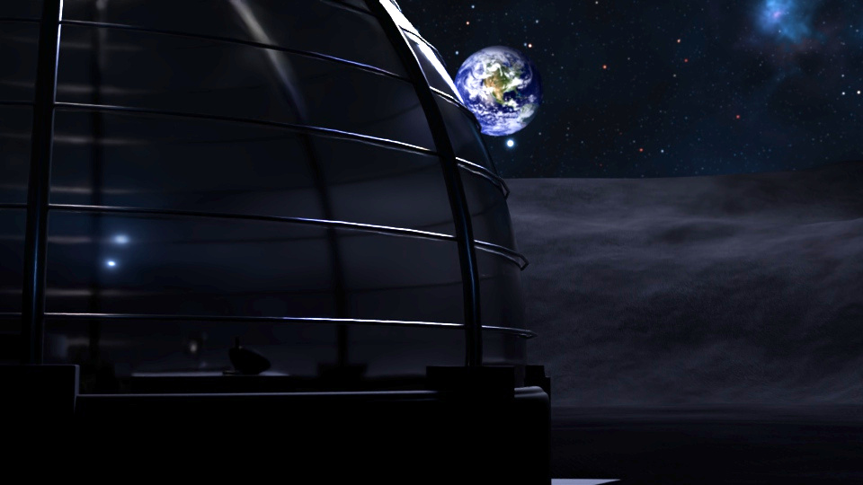
  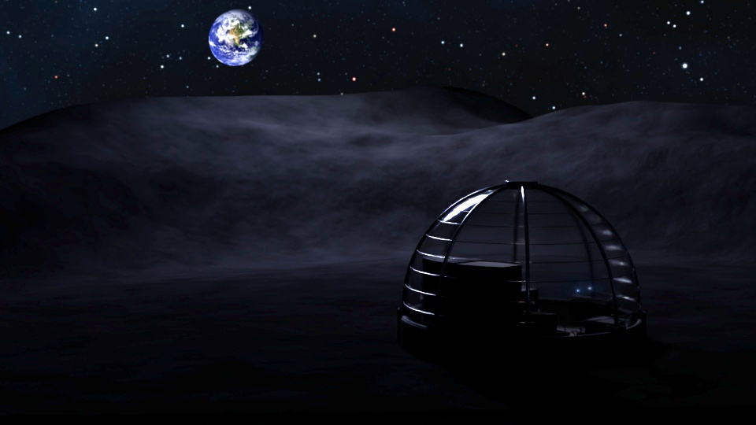

---

## Far - Music Video

Music video for Corvus Echoes' unreleased song *Far*. Animated in Blender.

  <iframe
    width="560"
    height="315"
    src="https://www.youtube.com/embed/heO6ELPbjA4"
    title="Far - Corvus Echoes"
    frameborder="0"
    allow="accelerometer; autoplay; clipboard-write; encrypted-media; gyroscope; picture-in-picture; web-share"
    allowfullscreen
  ></iframe>

---

## Collection of Animations

A series of hand-drawn 2D animations using Blender.

  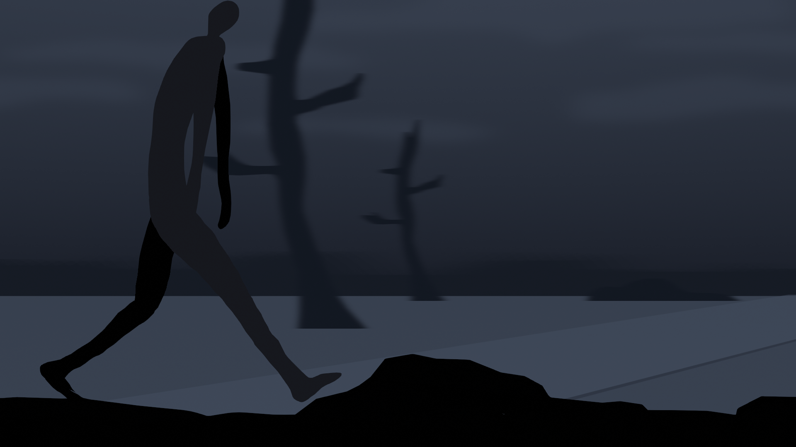
  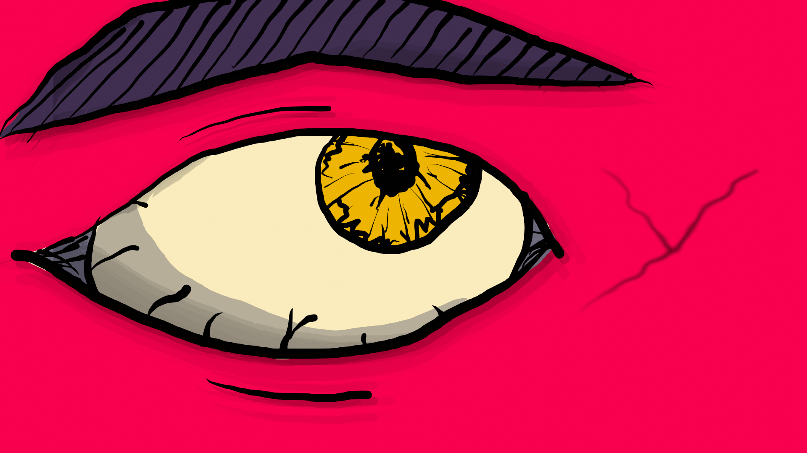
  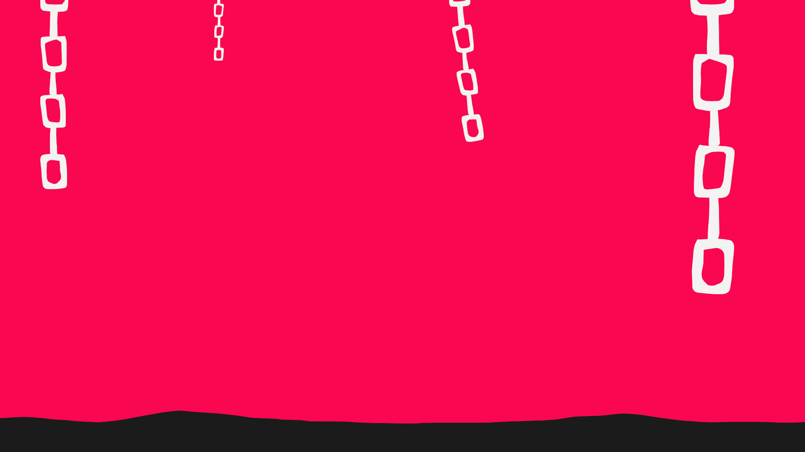

---

## Realize - Lyric Video

Lyric video short for Corvus Echoes' song *Realize*. Made in After Effects.

  <iframe
    width="560"
    height="315"
    src="https://www.youtube.com/embed/09adcBh83lk"
    title="Realize - Corvus Echoes"
    frameborder="0"
    allow="accelerometer; autoplay; clipboard-write; encrypted-media; gyroscope; picture-in-picture; web-share"
    allowfullscreen
  ></iframe>

---

## Fading of Memory - Lyric Video

Full lyric video for Corvus Echoes' song *Realize*. Made in After Effects.

  <iframe
    width="560"
    height="315"
    src="https://www.youtube.com/embed/M2OOjKf8wnw"
    title="Fading of Memory - Corvus Echoes"
    frameborder="0"
    allow="accelerometer; autoplay; clipboard-write; encrypted-media; gyroscope; picture-in-picture; web-share"
    allowfullscreen
  ></iframe>

---

## Minimal Website

<https://minimalsounddesign.netlify.app/>{:target="_blank" rel="noopener noreferrer"}

A minimal low-bandwidth website created with only HTML and CSS.

  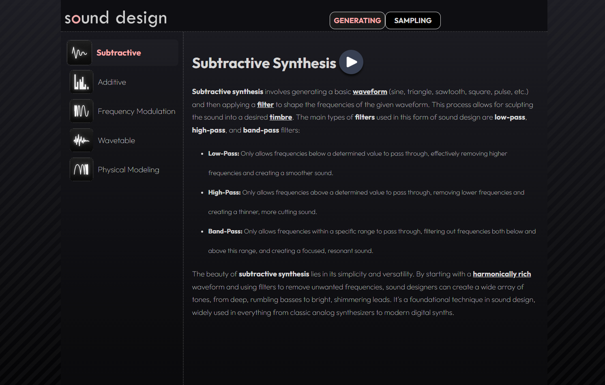

---

## Reflection

Though most of my professional work leans into UX and other various technical projects, studying New Media gave me a solid creative foundation that I carry into all of my work.
