## Project Overview

- **Type**: Frontend Development
- **Role**: Artist / Frontend Developer (Solo)
- **Timeline**: 5 weeks
- **Goal**: Build a convincing interactive art piece that creates an existentially significant experience for the person engaging with it.

---

## The Context

I've had a sustained interest in philosophy and existentially probing questions and experiences. As I often try to do, I thought of various projects that I could do that would combine my interest in philosophy and also frontend development. I conceptualized many different ideas, some overly large and complicated, others way too simple.

Then, I eventually landed on something so basic yet genuinely profound: An interactive quiz that asks the user questions that get continually more personal, and then the site starts stripping more and more agency from the user, until they finish; revealing all of the questions they've answered have changed, but keeping their same answers.

I saw this as an idea had enough potential to really create a meaningful existential experience for someone, while also being not all that difficult to build technically.

---

## The Process

### Ideation/Concept

In coming up with concepts for this project, I jumped between many different ideas for page elements and features. From ideas like using a flood of advertising and content to create the feeling of overwhelm, to using an LLM to change the user's answers, I landed on the much simpler and effective approach of the question-changing format. I immediately got to work drafting some questions (and their existential alternatives), and then made a flowchart.

  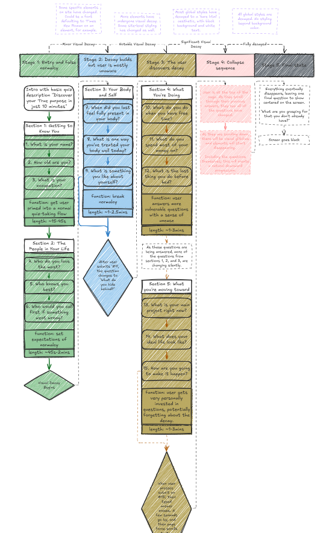

The narrative/emotional arc I wanted to take the user through was as following:

- **Set the user's initial expectation:** I wanted the user to feel as if they are simply taking a standard online quiz about 'finding their purpose'.
- **Site starts breaking to subvert those initial expectations:** I wanted to introduce some visual glitches on the site as to shift this initial comfort I established in the experience.
- **Site continues to break, first question change occurs:** Roughly half way through, I wanted to subtly reveal the core mechanism of the site by changing one of the questions on that question's submission to the existential alternative.
- **Site continues breaking until the last questions submission; the core mechanism now starts occurring:** When the user has submitted the last question, the site forcefully scrolls to the top, showing all of their answers with the changed questions. The site then starts 'destroying' itself from the top, eventually leading to the screen going black, and showing one last final question.

After coming up with the user experience, I wanted to get a solid idea of the visuals that would deliver this experience. I immediately got to drafting a visual mockup in penpot.

Though rough, this basic mockup image gave me a good start on actually building out the site structure and establishing a core aesthetic. I wanted the initial experience to feel extremely calming and welcoming to make the subversion land harder.

  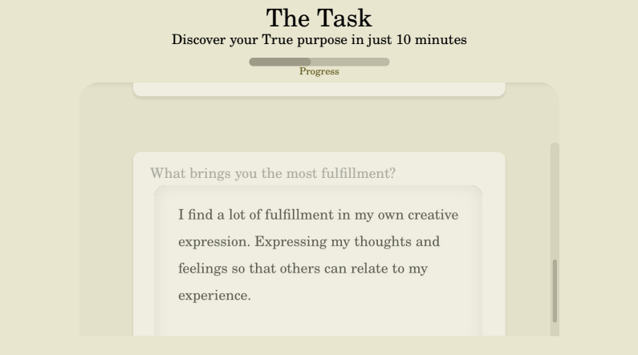

### The Execution

In building this website experience, I wanted to keep a few design and development philosophies and practices in mind as to make the process flow a lot smoother:

- The site itself should be constructed from a set of modular JavaScript files
- The questions themselves should be data, so their state can be changed
- The CSS should be entirely variable driven, and any site visual breaks/changes should be facilitated via separate CSS files that simply change the variables

With those ideas in place, I got to work.

  

    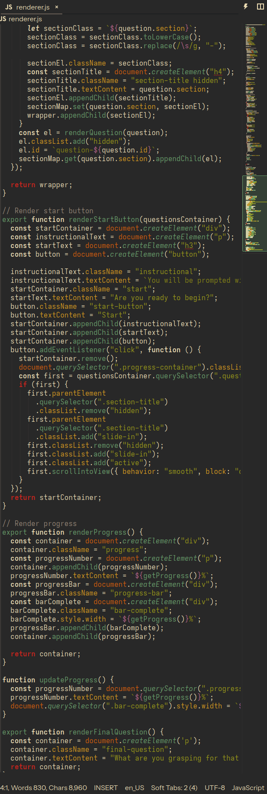
    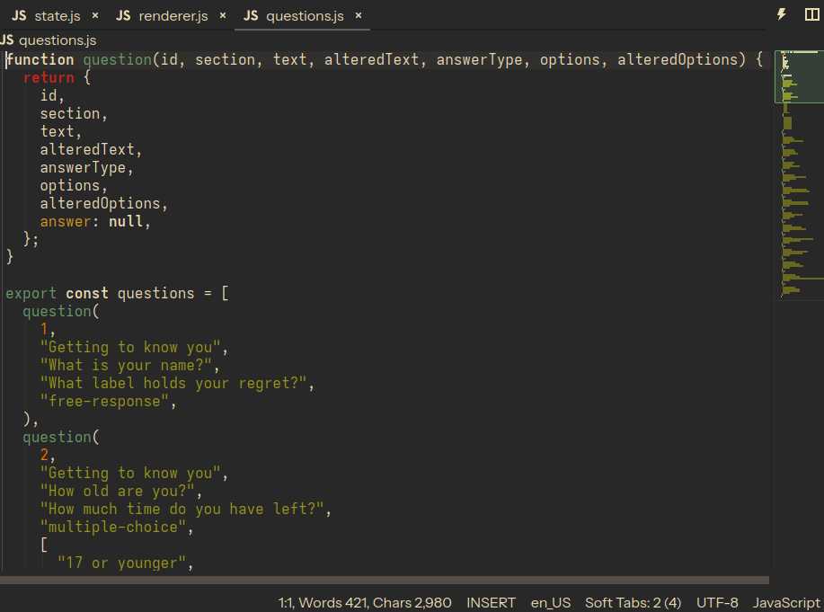
  

  

    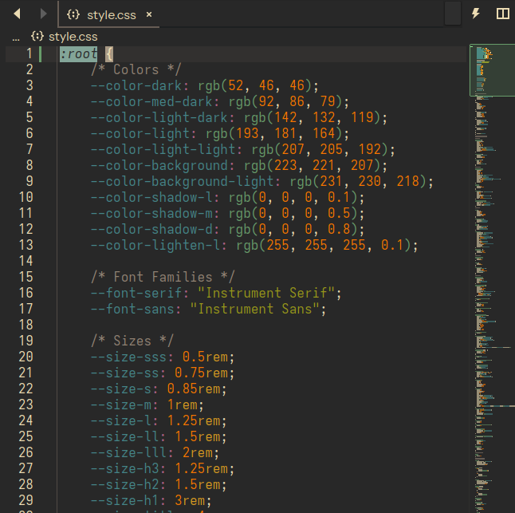
    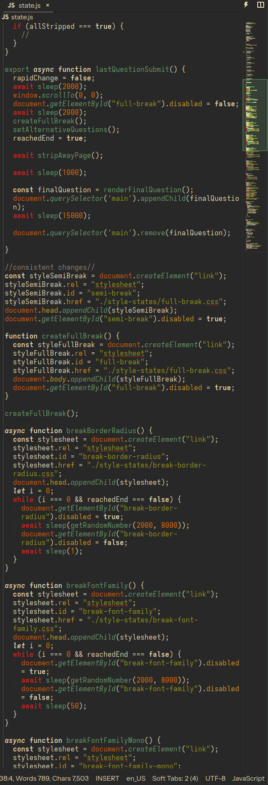
  

### The Result

After experimenting with different approaches, trying out different techniques, and assessing the overall experience, I finally got to a finished version of the interactive art experience.

  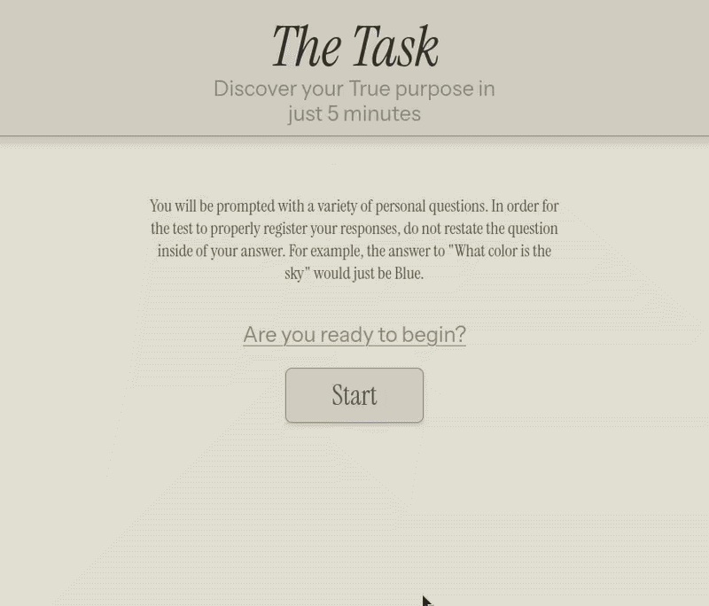
  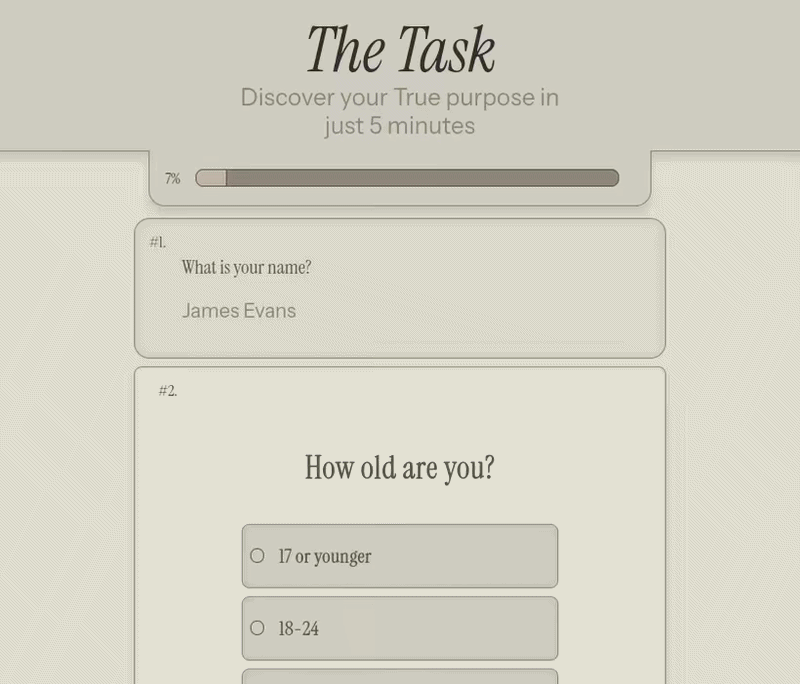
  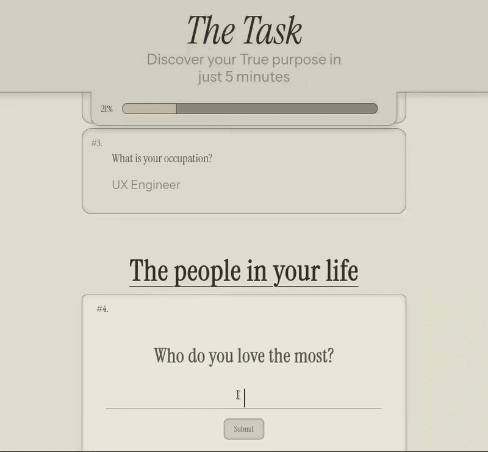
  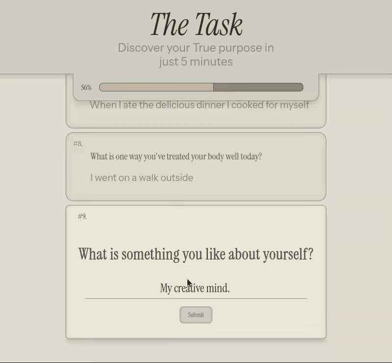
  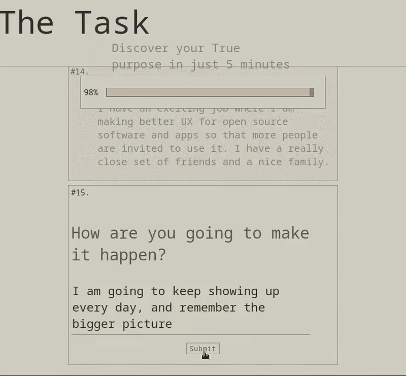
  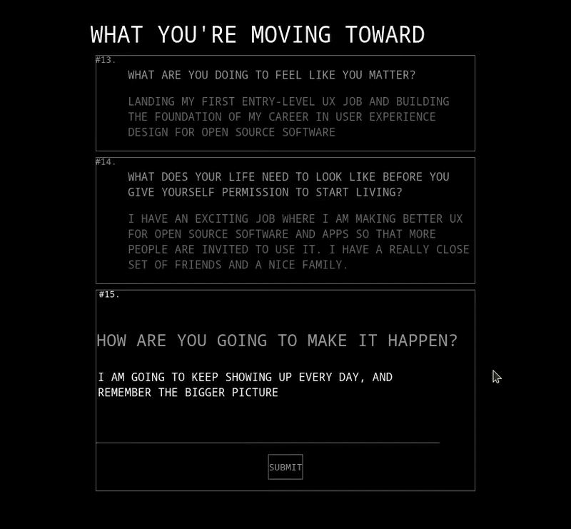

---

## Takeaways

In a backwards way, I found I learned a lot more about the process of UX, by initially creating a smooth polished user experience, and then trying to make it intentionally jarring. By building a project meant to evoke discomfort, I have learned what things I should and shouldn't do when designing and developing commercial UX experiences.

It was truthfully a surreal experience engaging with this project myself; I knew exactly how it was going to unfold in-front of my eyes, because I made it, and still it was a fascinating emotional experience being in the position of the user.
